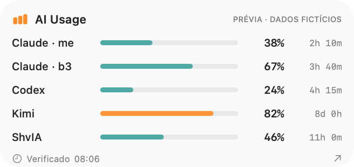
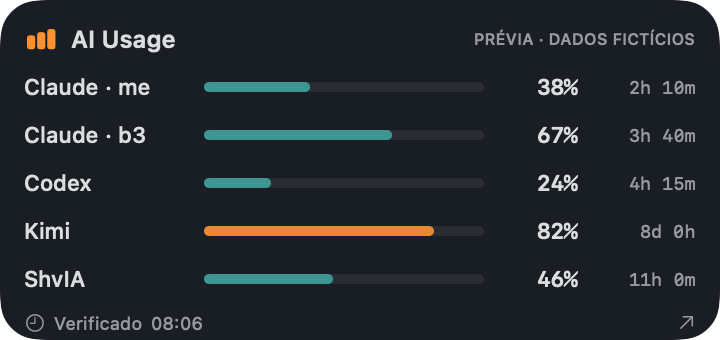

# Native macOS WidgetKit prototype

The medium widget shows Claude `me`/`b3`, Codex, Kimi, and ShvIA. These are
synthetic screenshots of the actual SwiftUI view, not live account data:




This optional build packages the existing Swift menu bar executable as a
containing app with a real WidgetKit extension. It requires macOS 14 or later,
Xcode, Python 3, and an existing Apple signing identity. It does not replace
the separately packaged Rust tray app.

The host keeps the bundle identifier and executable name
`ai-usagebar-menubar`, preserving the standalone menu bar's existing
`UserDefaults.standard` domain. The build does not migrate or rewrite
preferences, CLI configuration, credentials, or the LaunchAgent.

## Readings and freshness

The medium widget has five fixed slots: `Claude · me`, `Claude · b3`,
`Codex`, `Kimi`, and `ShvIA`. Only configured, enabled accounts are collected.
A missing or disabled account has an explicit unavailable state; it never
becomes an invented 0% reading. The host combines the menu's selected entries
with these widget slots in its existing serial refresh worker and deduplicates
accounts. There is no second refresh timer or independent credential reader.

Only a bounded display snapshot crosses into the shared container. Its
`checkedAt` records when the host observed the CLI output, not when the
provider fetched the underlying quota. The footer therefore says when the
reading was checked. A provider's stale marker is preserved, and available
readings also become stale after the larger of five minutes or three menu
refresh intervals, or when their known reset time passes. Timeline entries
schedule these stale transitions even if the host stops publishing.

The host requests a WidgetKit reload when readings change or after a
300-second heartbeat, instead of requesting one for every unchanged menu
tick. A 900-second timeline fallback reads only the shared file. WidgetKit
controls when reloads actually occur; these intervals are requests, not a
guarantee of continuously refreshed data. Gallery examples are explicitly
marked as synthetic previews.

## Build without installing

List available signing identities, which exposes certificate metadata only:

```sh
security find-identity -v -p codesigning
```

Use the identity's actual Team ID and a fresh output path:

```sh
./macos/widget/build.sh \
  --sign-identity "Developer ID Application: Your Organization (TEAMID)" \
  --team-id YOURTEAMID \
  --output "$PWD/target/macos-widget/AI UsageBar.app"
```

The script compiles serially at background priority, signs the extension
before the containing app, and verifies both signatures and their Team IDs.
It refuses to overwrite an existing output. `--version` defaults to the
fork version in `version.md`; `--arch` defaults to the current Mac's
architecture. `--host-binary` can reuse a host already built with
`-D WIDGET_HOST`, `WidgetSnapshot.swift`, and `WidgetPublisher.swift`.
An ordinary standalone host does not publish widget snapshots.

The final artifact contains:

```text
AI UsageBar.app/Contents/
  Info.plist
  MacOS/ai-usagebar-menubar
  Resources/AIUsage.icns
  PlugIns/AIUsageBarWidget.appex/Contents/
    Info.plist
    MacOS/AIUsageBarWidget
```

Building does not install, launch, register, or restart anything. A separate
installation step can copy the verified bundle to `~/Applications` after
backing up the existing app and preserving its launch configuration. Launch
the containing app once after installation: Apple requires this before its
widget appears in the widget gallery. Gallery discovery and an actual
desktop widget remain runtime acceptance checks, separate from compilation.

Before the first launch, unload the old menu's exact LaunchAgent to avoid a
second collector and duplicate global hotkeys. Open the installed containing
app once through Finder or LaunchServices. If startup should stay enabled,
quit this manually launched instance, change only the existing LaunchAgent's
`ProgramArguments[0]` to the executable inside the installed app, and bootstrap
that same plist. Preserve its label, remaining arguments, `RunAtLoad`, mode,
and other keys. Verify one running menu process after bootstrap. Restore the
saved original plist and bootstrap it if activation fails; the standalone
binary and CLI do not need to be overwritten.

On the validation notebook, an initial bootstrap returned error 5 before the
first LaunchServices launch. Opening the containing app once and then
bootstrapping succeeded. This sequence is verified; the exact cause of the
initial error was not established. Do not reset background-item databases,
disable Gatekeeper, or change unrelated privacy permissions to work around it.

## Installation and rollback boundaries

Before installing, preserve the existing app if present and make a private
backup of `~/Library/LaunchAgents/com.akitaonrails.ai-usagebar-menubar.plist`.
Keep the original standalone Swift executable and configured CLI in place.
The installation changes only the existing LaunchAgent's executable argument
to `~/Applications/AI UsageBar.app/Contents/MacOS/ai-usagebar-menubar`;
preserve the other `ProgramArguments`, plist keys, and start-at-login choice.
Unload the existing job before loading its updated plist so the two hosts do
not run concurrently. If start-at-login was disabled, keep it disabled and
launch the bundled app manually.

To roll back, unload the bundled host's job, restore the original plist from
that backup, and reload the restored job only if it was previously enabled.
For a manually started host, quit the bundled host and reopen the preserved
standalone executable instead. Restore any prior app bundle from its backup.
The existing preference domain and CLI configuration need no migration or
reset. Removing a desktop widget through macOS is separate from restoring
the menu bar host; do not delete other apps' shared containers.

## Shared container and signing

Both bundles declare `AIUsageWidgetAppGroup` in `Info.plist` and the same
`com.apple.security.application-groups` entitlement:
`<TEAM_ID>.ai-usagebar.widget`. The model resolves this container through
`FileManager.containerURL(forSecurityApplicationGroupIdentifier:)` and uses
`snapshot.json`; no home-directory or credential-store fallback is packaged.
The extension is sandboxed and has no network entitlement. The host remains
nonsandboxed so the existing CLI and menu behavior can continue unchanged.

Apple supports the `TEAM_ID.group-name` format specifically on macOS without
registering an App Group or embedding a provisioning profile. The signing
team must match the prefix. This prototype uses that macOS-only form; the
`group.` form instead requires a provisioning profile. See Apple's
[app group authorization documentation](https://developer.apple.com/documentation/xcode/accessing-app-group-containers).

The script uses the existing certificate for local validation with no
timestamp or notarization submission. A signed local build is not a
notarized distributable release. No Developer portal, runner, or signing
account settings are changed.

macOS may prevent an unrelated terminal or coding app from directly reading
the protected App Group file, even for the same user. The signed host and
extension are its intended readers. Do not grant broader filesystem access
or change container ACLs for inspection; validate the displayed widget and
the containing app instead.

## Checks

```sh
./macos/widget/run-tests.sh
```

The aggregate runner checks the model, publisher, packaging, and extension
compilation without a certificate; the macOS CI job runs it too. Packaging
tests use synthetic binaries and temporary directories; they never invoke a
signing key or read real settings. The production extension uses
the `com.apple.widgetkit-extension` extension point from Apple's Xcode
template. See [Creating a widget extension](https://developer.apple.com/documentation/widgetkit/creating-a-widget-extension)
for containing-app discovery, supported families, and timeline behavior.
